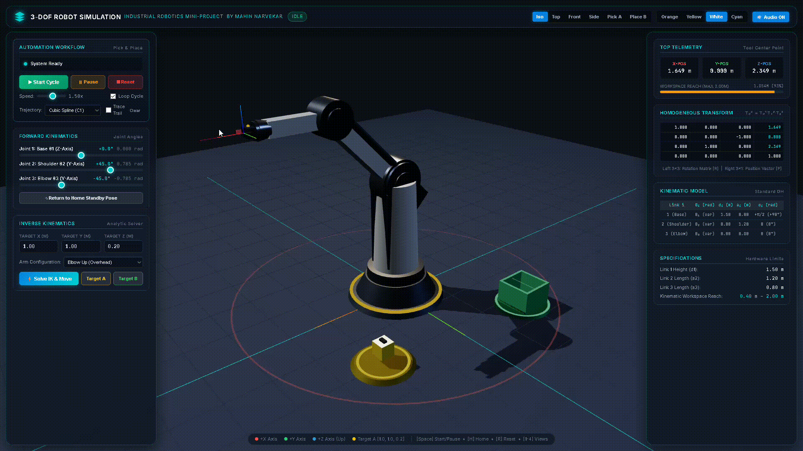

# 3-DOF Pick-and-Place Industrial Robot Simulation App

A high-precision, interactive, web-based 3D industrial robotics simulation built with **HTML5**, **JavaScript (Three.js)**, and modern **CSS3**. Demonstrates Forward Kinematics, Closed-Form Analytic Inverse Kinematics, Cubic & Quintic Trajectory Interpolation, and Autonomous Pick-and-Place Automation for a 3-DOF revolute spatial robot arm (3-RRR).

---

<p align="center">
  
</p>

## 🚀 Key Features

- **Kinematic Configuration**: 3-Revolute Joints (Base rotation $\theta_1$ around $Z$, Shoulder rotation $\theta_2$ around $Y$, Elbow rotation $\theta_3$ around $Y$).
- **Physical Robot Dimensions**:
  - **Link 1** (Pedestal / Turret Height): $d_1 = 1.5\,\text{m}$
  - **Link 2** (Upper Arm Boom): $a_2 = 1.2\,\text{m}$
  - **Link 3** (Forearm & Tool Flange): $a_3 = 0.8\,\text{m}$
  - **Total Spherical Reach**: $R_{\max} = a_2 + a_3 = 2.0\,\text{m}$
  - **Inner Dead-zone**: $R_{\min} = |a_2 - a_3| = 0.4\,\text{m}$
- **Mathematical Engines**:
  - **Forward Kinematics (FK)**: Analytical position and full $4 \times 4$ Denavit-Hartenberg (DH) transformation matrix calculation.
  - **Analytic Inverse Kinematics (IK)**: Closed-form trigonometric solver using the Law of Cosines with automated boundary clamping and singularity resolution.
  - **Trajectory Interpolation**: Cubic polynomial ($C^1$ continuity) and Quintic minimum-jerk ($C^2$ continuity) splines with zero boundary velocities and accelerations.
- **Pick-and-Place Automation**:
  - **Target A** (Pick Location): $[X=1.0, Y=1.0, Z=0.2]$ with Yellow Workpiece Cube.
  - **Target B** (Place Location): $[X=-1.0, Y=1.2, Z=0.2]$ with Green Drop Box.
  - **State Machine**: Home $\to$ Approach A $\to$ Descend $\to$ Grasp Cube $\to$ Retract Upward $\to$ Transit to B $\to$ Descend into Box $\to$ Release $\to$ Retract $\to$ Return Home.
- **3D Graphics & Engineering HUD**:
  - Industrial PBR materials with metallic finish, chamfered joints, counterweights, and parallel-jaw gripper.
  - Studio multi-point lighting with soft dynamic shadows (`PCFSoftShadowMap`).
  - Real-time trajectory trail ribbon tracing the Tool Center Point (TCP).
  - Web Audio API synthesizer for realistic servomotor pitch modulation and pneumatic latch sounds.
  - Dynamic $4 \times 4$ DH Transformation Matrix ($T_0^3$) output in real-time.

---

## 📐 Kinematic Formulations

### Standard Denavit-Hartenberg (DH) Table

| Link $i$ | Joint Angle $\theta_i$ | Joint Distance $d_i$ | Link Length $a_i$ | Link Twist $\alpha_i$ |
| :---: | :---: | :---: | :---: | :---: |
| **1 (Base)** | $\theta_1$ (Variable) | $1.5\,\text{m}$ | $0.0\,\text{m}$ | $+90^\circ\ (+\pi/2\,\text{rad})$ |
| **2 (Shoulder)** | $\theta_2$ (Variable) | $0.0\,\text{m}$ | $1.2\,\text{m}$ | $0^\circ\ (0\,\text{rad})$ |
| **3 (Elbow)** | $\theta_3$ (Variable) | $0.0\,\text{m}$ | $0.8\,\text{m}$ | $0^\circ\ (0\,\text{rad})$ |

### Forward Kinematics (FK)
Given joint angles $\theta_1, \theta_2, \theta_3$:

$$\theta_{23} = \theta_2 + \theta_3$$

$$r = a_2 \cos(\theta_2) + a_3 \cos(\theta_{23})$$

$$X = r \cos(\theta_1)$$

$$Y = r \sin(\theta_1)$$

$$Z = d_1 + a_2 \sin(\theta_2) + a_3 \sin(\theta_{23})$$

At **Home Position** $[\theta_1 = 0^\circ, \theta_2 = 45^\circ, \theta_3 = -45^\circ]$:
- $\theta_{23} = 0^\circ$ (Forearm horizontal)
- $r = 1.2 \cos(45^\circ) + 0.8 \cos(0^\circ) \approx 1.6485\,\text{m}$
- $X = 1.6485\,\text{m},\ Y = 0.0\,\text{m},\ Z = 2.3485\,\text{m}$

### Analytic Inverse Kinematics (IK)
Given target coordinates $(X, Y, Z)$:

1. **Base Rotation $\theta_1$**:
   $$\theta_1 = \operatorname{atan2}(Y, X)$$
   *(If $X=Y=0$, preserve current $\theta_1$ to handle shoulder singularity).*

2. **Planar Projection & Distance from Shoulder**:
   $$r = \sqrt{X^2 + Y^2},\quad z' = Z - d_1,\quad D = \sqrt{r^2 + (z')^2}$$

3. **Reachability Boundary Clamping**:
   If $D > (a_2 + a_3)$, scale $(r, z')$ by $\frac{a_2 + a_3 - \epsilon}{D}$ to project gracefully onto the boundary surface.

4. **Elbow Angle $\theta_3$**:
   $$\cos(\theta_3) = \operatorname{clamp}\left(\frac{D^2 - a_2^2 - a_3^2}{2 a_2 a_3}, -1.0, 1.0\right)$$
   $$\theta_3 = -\arccos(\cos\theta_3)\quad \text{(Elbow-down)}$$

5. **Shoulder Angle $\theta_2$**:
   $$\beta = \operatorname{atan2}(z', r),\quad \gamma = \arccos\left(\frac{a_2^2 + D^2 - a_3^2}{2 a_2 D}\right)$$
   $$\theta_2 = \beta + \gamma\quad \text{(Elbow-down)}$$

---

## 📁 File Structure

```text
robot-arm-simulation/
├── index.html         # Main application webpage with WebGL canvas & HUD
├── style.css          # Dark cyber-industrial glassmorphism styles
├── kinematics.js      # Pure math engine: FK, analytic IK, DH, trajectory
├── robot.js           # Three.js 3D meshes, joints, gripper, workpiece
├── app.js             # Controller, automation state machine, Web Audio
├── test.html          # Automated in-browser verification test runner
├── test_runner.js     # Standalone verification script
└── lib/               # Self-contained offline Three.js libraries
    ├── three.min.js   # Three.js r128 WebGL library
    └── OrbitControls.js # Camera orbital navigation controls
```

---

## 🎮 Controls & Shortcuts

| Action | Control / Shortcut |
|---|---|
| **Rotate Camera** | Left-click + Drag |
| **Pan Camera** | Right-click + Drag |
| **Zoom View** | Mouse Scroll Wheel / Pinch |
| **Play / Pause Automation** | Spacebar or Click `▶ Start Cycle` |
| **Home Position** | Press `H` or Click `Return to Home` |
| **Reset Scene** | Press `R` or Click `⏹ Reset` |
| **Camera Views** | Keys `1` (Iso), `2` (Top), `3` (Front), `4` (Side) |
| **Mute / Unmute Audio** | Click `🔊 Audio ON` |

---

## 🌐 How to Run

1. Open `index.html` directly in any modern web browser (Google Chrome, Microsoft Edge, Firefox, Safari).
2. No build tools, package managers, or server installations required.
3. The app includes local copies of all vendor libraries with automatic CDN fallback.
